# Cultural Diversity and National Identity in Bangladesh: Historical and Political Perspectives

Masters-level seminar deck · 17 slides · 10–15 minutes · English · 16:9

**Photo source rule (user decision):** Wikimedia Commons / freely-licensed real photographs only.
**Transitions (user decision):** morph_mix — Morph between related slides, varied fade/push/wipe elsewhere (injected post-assembly).
**Style (user decision):** bold editorial "editorial_bengal" v1 — ivory canvas, bottle-green + vermilion, jamdani motifs.

---

## Slide 1 — Cover: Cultural Diversity and National Identity in Bangladesh
- Subtitle: Historical and Political Perspectives
- Seminar framing line + date
- Required image: panorama strip of Lalbagh Fort — 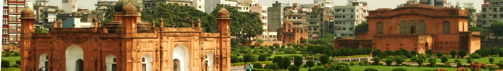 (strict input asset; crop to wide strip)

## Slide 2 — Language Movement and Ekushey February
- 1952 movement for Bangla as state language; 21 February as International Mother Language Day (UNESCO 1999)
- Cards: 1952 · 1972 (Art. 3: Bangla) · 1999 (UNESCO)
- Required images: Central Shaheed Minar — 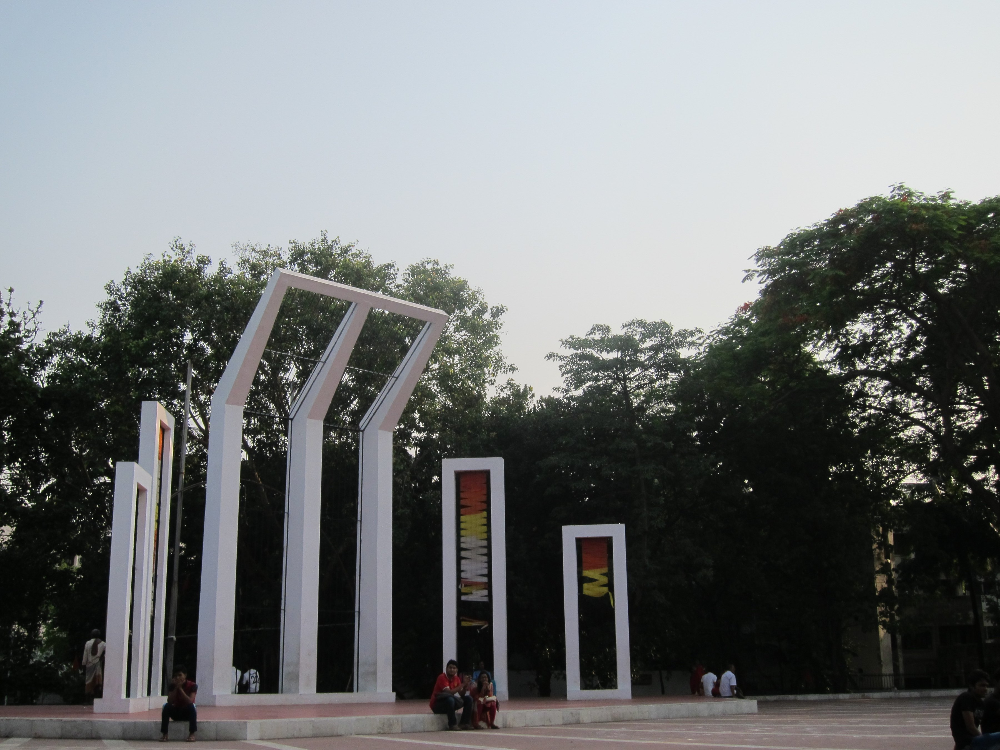 (strict input asset); 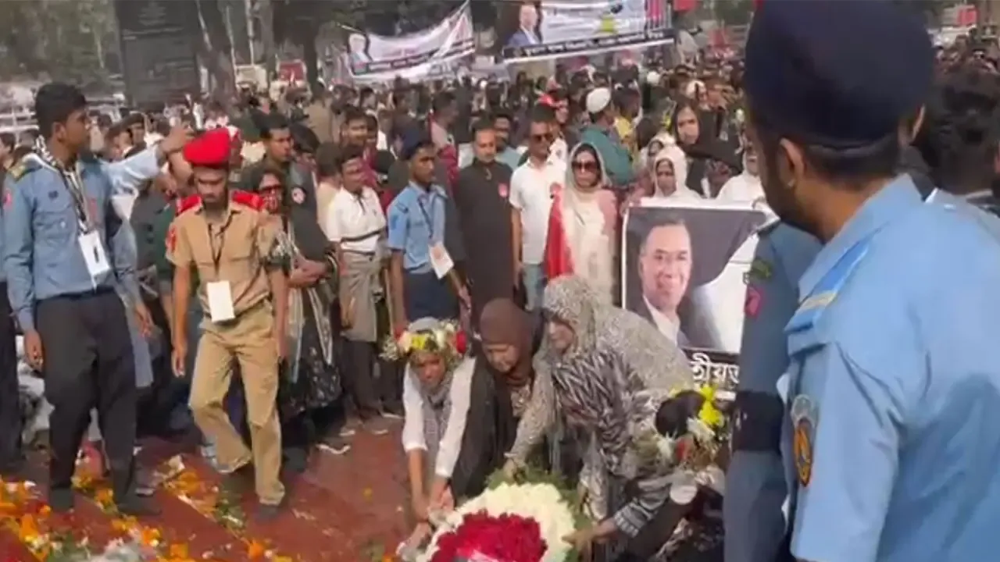 (strict input asset)

## Slide 3 — From Partition to Liberation, 1947–1971
- 1947 Partition; refugee flows; 1971 Liberation War and genocide; victory 16 December
- Required images: 1947 refugees — 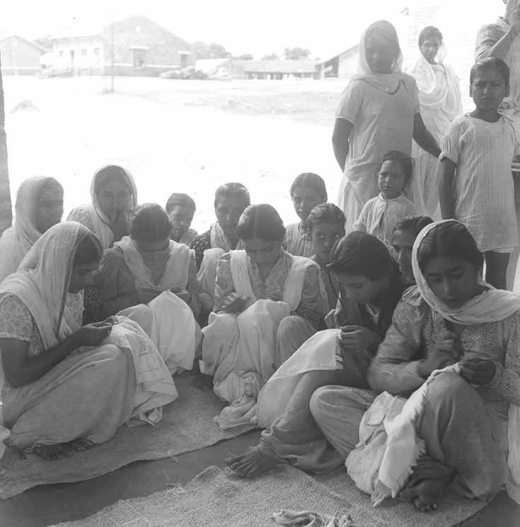 (strict input asset); Liberation War Museum sculpture — 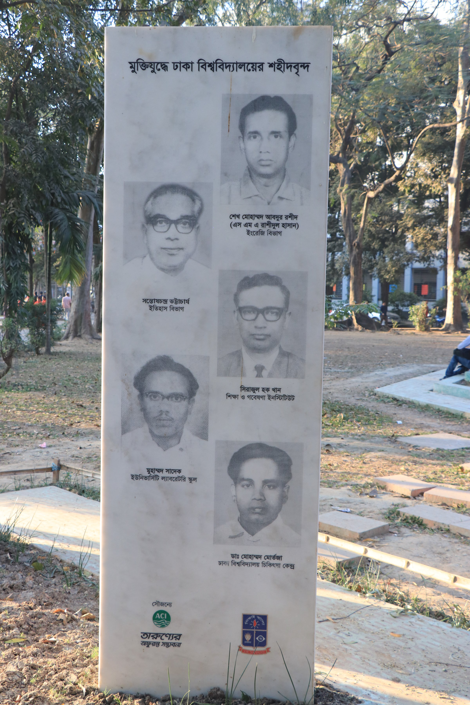 (strict input asset)

## Slide 4 — Constitution, Principles, and the Secularism Debate
- 1972 Constitution: nationalism, socialism, democracy, secularism
- Fifth Amendment (removed secularism; added Bismillah), Eighth Amendment (1988: state religion), 2005 High Court ruling, Fifteenth Amendment (2011: restored secularism; Article 12 anti-communalism; Article 2A keeps Islam as state religion)
- Required image: Martyrs' Memorial, Savar — 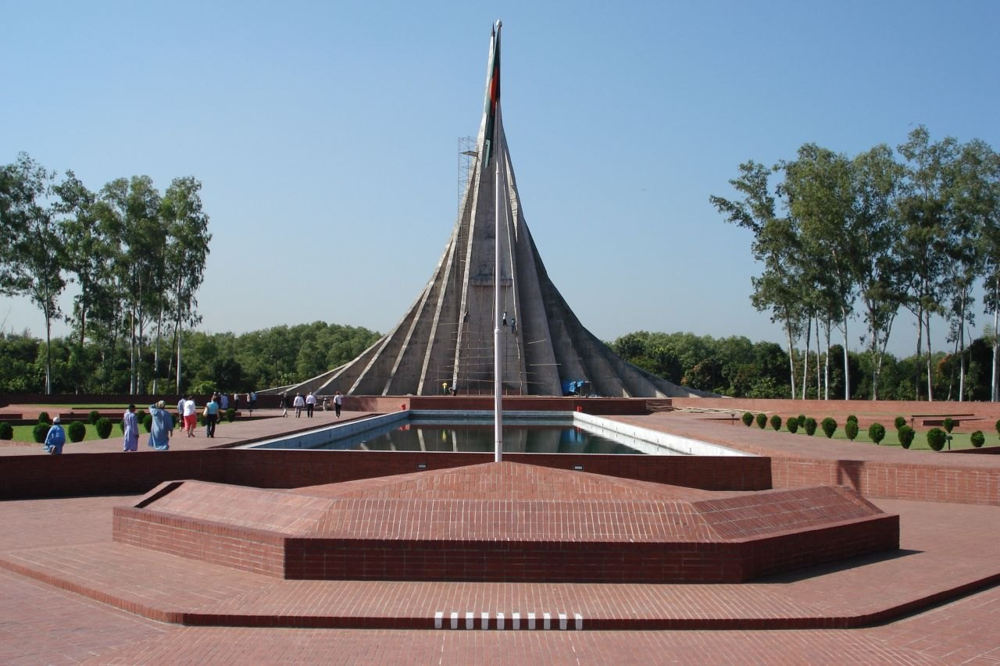 (strict input asset)

## Slide 5 — The Islamic Heritage of Bengal
- Muslims ~91% (Census 2022); Baitul Mukarram national mosque; Sufi shrines and mazar culture; Baul–Sufi synthesis (UNESCO ICH 2005)
- Required image: Baitul Mukarram — 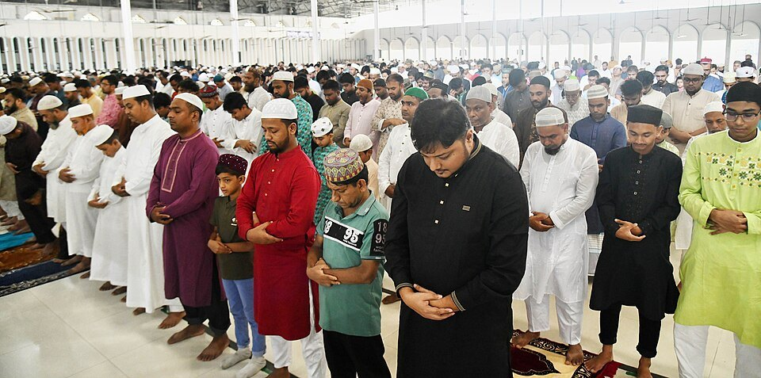 (strict input asset)

## Slide 6 — Four Threads of Identity *(approved style sample)*
- Overview: language · faith · indigenous peoples · memory of 1971
- Sets the deck's analytic frame; visual showcase slide
- (No strict photo required; style sample governs)

## Slide 7 — Who Is Indigenous? Counting and Naming the Peoples
- Census 2022: 1,650,159 persons across 50 groups; activist estimates ≥3 million (caveat box: definitions disputed — govt says "ethnic minority", UN says "indigenous")
- Largest: Chakma 483,299; Marma 224,261; Tripuri 156,578; Santal 129,049; Oraon 85,846; Garo 76,846
- Required image: Chakma/Marpa family — 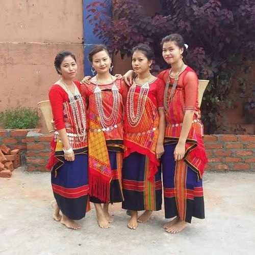 (strict input asset)

## Slide 8 — Temples, Viharas, and Churches
- Hindu institutions: Dhakeshwari state temple; Buddhist: Buddha Dhatu Jadi, Bandarban; Christian: Holy Cross Church tradition, missionaries since 16th c.
- Article 41 freedom of professing religion in practice
- Required images: Dhakeshwari Temple — 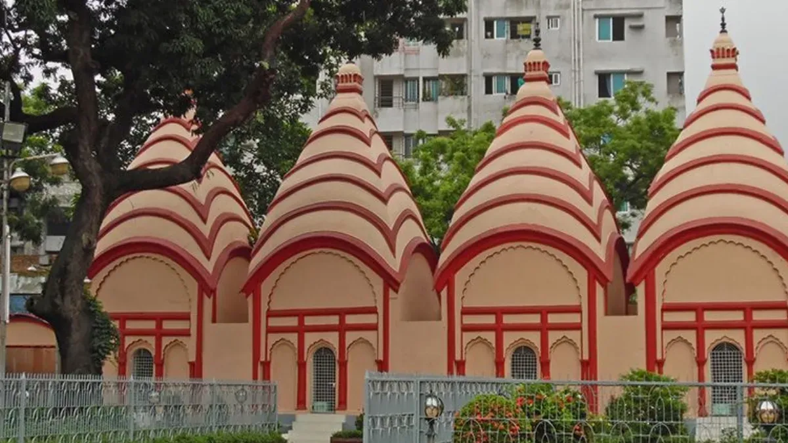 (strict input asset); Holy Cross Church — 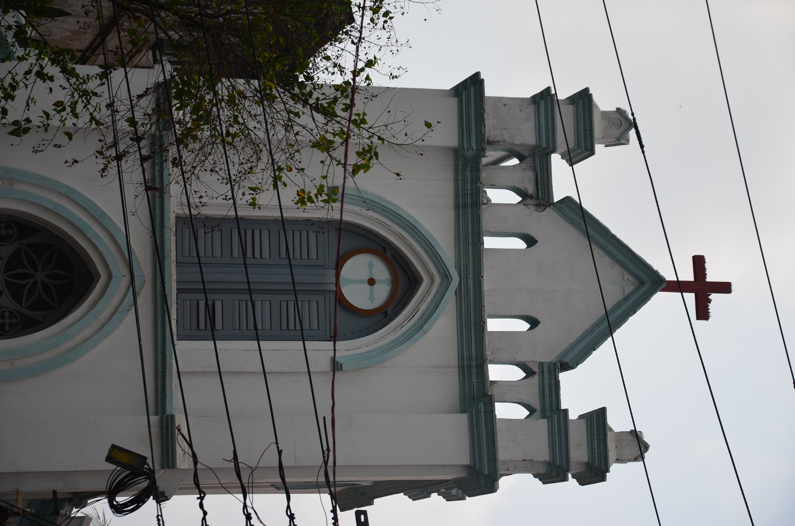 (strict input asset); Buddha Dhatu Jadi — 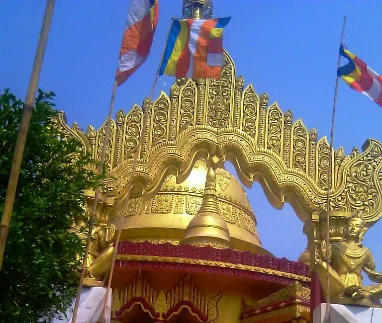 (strict input asset)

## Slide 9 — Census 2022: The Religious Mosaic in Numbers
- Donut: Muslim 91.04%, Hindu 7.95%, Buddhist 0.61%, Christian 0.30%, other 0.12%; total 169.8M
- Hindu-share step trend: 28% (1941) → 22% (1951) → 13.5% (1974) → 8.54% (2011) → 7.95% (2022)
- Article 41 strip; 2×2 photo grid (mosque/temple/church/golden temple)
- Required images: same four faith photos — mosque_baitul_mukarram.jpg, temple_dhakeshwari.webp, church_holy_cross.jpg, buddhist_golden_temple.webp (all strict input assets)

## Slide 10 — Ethnic Peoples and Their Arts
- Chakma, Marma, Tripuri, Santal, Oraon, Garo, Rakhaine, Tanchangya; ~54 peoples, ≥35 languages
- Wangala harvest festival (Garo); lifang/loom arts; drum and dance traditions
- Required image: Wangala dancers — 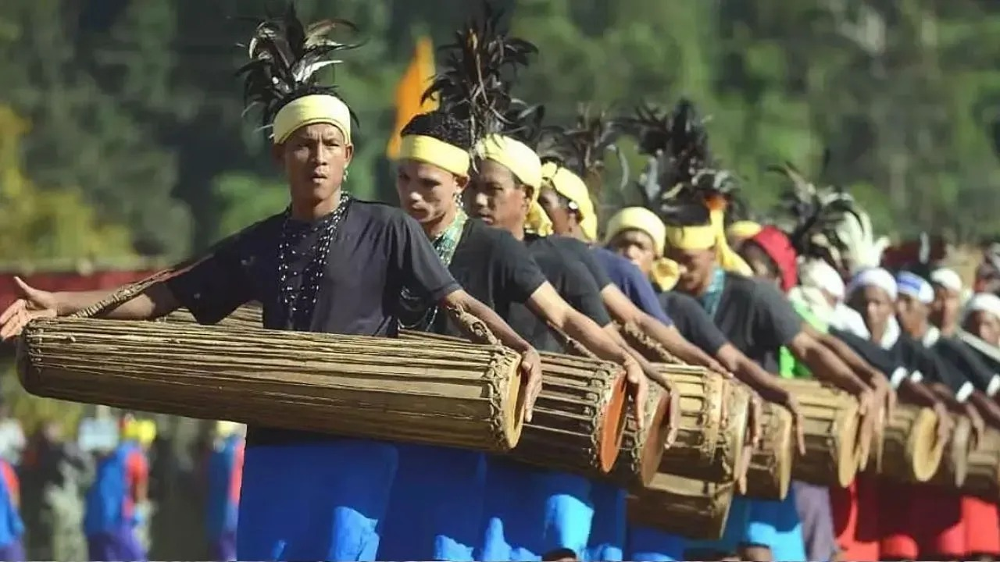 (strict input asset)

## Slide 11 — Chittagong Hill Tracts: Accord and After
- CHT Accord 2 December 1997: Ministry of CHT Affairs, CHT Regional Council, three Hill District Councils, Land Commission
- Unfinished business: no council elections in 27 years; land disputes; ~8,140 killed/injured/missing during conflict (Dey 2024); Kroc Institute peace-score 49/100 (first decade)
- Required image: Rangamati/Kaptai — 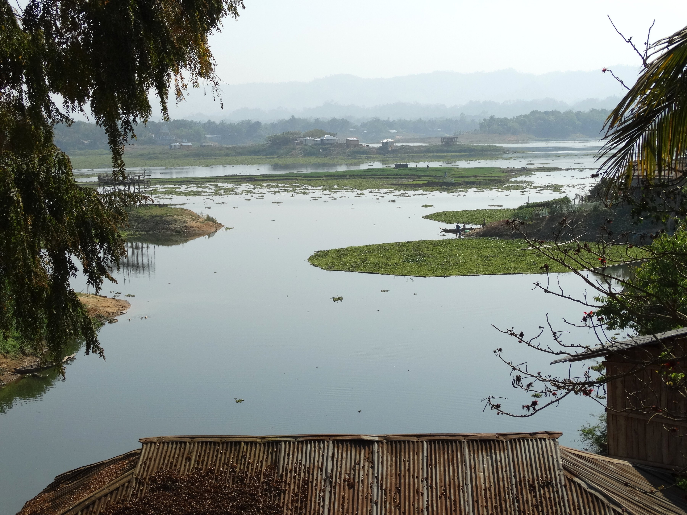 (strict input asset)

## Slide 12 — The Rohingya Crisis
- ~1.1–1.2M Rohingya in Bangladesh; 33 camps in Cox's Bazar + Bhasan Char
- ~700,000 fled Myanmar after 27 Aug 2017; ~150,000 new arrivals since early 2024
- 2025 deadliest sea year (~900 dead/missing); UNHCR 2026 appeal $710.5M (26% below prior); UNGA High-Level Conference 30 Sep 2025
- Required image: camp aerial —  (strict input asset)

## Slide 13 — Urban Minorities: Biharis and the Politics of Belonging
- Urdu-speaking Bangladeshis: ~300–400k in 116 camps since 1971; Geneva Camp (Mohammadpur) largest (~21,700–25,000)
- Stateless until Supreme Court 2008 ruling recognized them as "Urdu-speaking Bangladeshis"
- Citizenship, belonging, and urban exclusion
- Required image: Geneva Camp —  (strict input asset)

## Slide 14 — Festivals and Intangible Heritage
- Mangal Shobhajatra (UNESCO ICH 2016, ref. 01091, from 1989); Baul songs (UNESCO 2005)
- Pahela Baishakh, Durga Puja national holiday, Eid cycle, Wangala; Jamdani weaving (UNESCO ICH 2008)
- Required images: Mangal Shobhajatra — 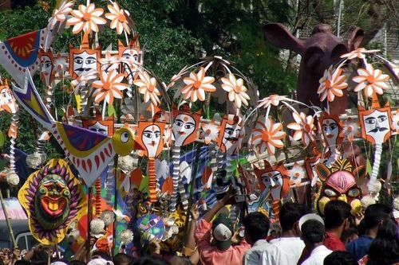 (strict input asset); Jamdani loom — 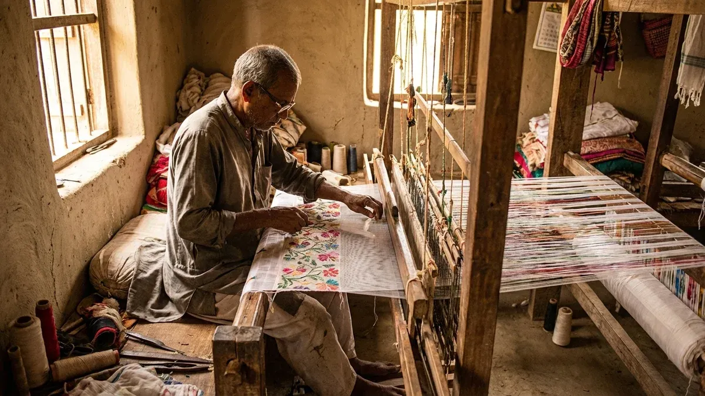 (strict input asset)

## Slide 15 — 2024–2026: Upheaval, Election, and the Minority Question
- July–August 2024 uprising; Hasina fled 5 Aug 2024; Yunus-led interim government
- Violence data: Ain o Salish Kendra 138 violent incidents against religious minorities Jan–Nov 2024 (mostly 5–8 Aug); contested higher counts (India MEA 2,200 / Oikya Parishad 2,010 vs Dhaka's "highly exaggerated")
- 12 February 2026 general election (13th Sangsad): BNP 209/297 gazetted seats (49.97%), Jamaat 68 (31.76%), NCP 6; turnout 59.44%; Awami League barred
- Tarique Rahman sworn in 17 Feb 2026; minority posture: rights/security "rather than on the basis of religion" (12 Oct 2026); police security at ~33,000 Durga Puja venues (Oct 2026); open tests ahead
- (No strict photo; data-and-timeline slide)

## Slide 16 — Conclusion: Identity as Negotiation
- Bangladesh holds unity (language, 1971 memory) and pluralism (faiths, peoples, languages) in creative tension
- Constitutional arc: secularism out and back; Article 12 as civic promise
- Takeaways: counting is politics; minorities are barometers; the story is ongoing

## Slide 17 — References and Sources
- Census 2022 (BBS); UNHCR Rohingya emergency updates 2025–26; UNESCO ICH lists (01091, Baul, Jamdani)
- Constitutional amendments (Daily Star; AJCL 69(3); Asian Survey/10.1080/07329113.2017.1341479)
- CHT Accord analyses (UNPO; ANU; Daily Star; Indigenous Navigator; Dey 2024; Kroc Institute)
- ASK human rights reports 2024–25; election results (Feb 2026, gazette); UNHCR 2026 appeal
- Photo credits: Wikimedia Commons (per-figure sources in assets/figures/SOURCES.md)
